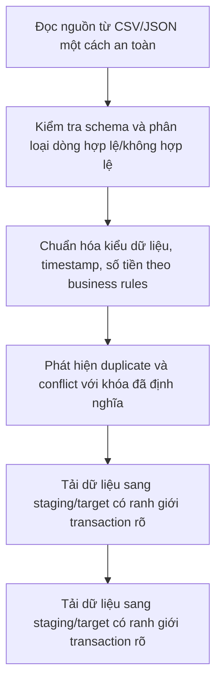

# Reliable Python ETL Engine

**Module 01 — Engineering Foundations · Project 03 | OmniCommerce Data Platform**

> Xây dựng ETL engine xử lý dữ liệu bán hàng từ file/API, có validation, transformation, idempotency và kiểm thử.

**Trạng thái: Planned — repository định hướng học tập, CHƯA có implementation.** README này trình bày phạm vi dự kiến, không phải tuyên bố hệ thống đã chạy hoặc đạt benchmark.

## 1. Tổng quan và bài toán nghiệp vụ

OmniCommerce là doanh nghiệp thương mại điện tử giả lập dùng xuyên suốt lộ trình Data Engineering. **Bài toán của Project 03:** Dữ liệu đơn hàng đến từ nhiều nguồn với ngày tháng, tiền tệ, null, duplicate và schema không thống nhất. Nếu biến đổi sai, doanh thu báo cáo bị sai.

Dự án được thiết kế để chứng minh không chỉ khả năng dùng công cụ mà cả cách phân tích yêu cầu, thiết kế giải pháp, nhận diện tình huống lỗi, kiểm thử và vận hành có thể giải thích được.

## 2. Mục tiêu và giá trị mang lại

- **Business goal:** Xây dựng ETL engine xử lý dữ liệu bán hàng từ file/API, có validation, transformation, idempotency và kiểm thử.
- **Engineering goal:** Hiểu kiến thức nền tảng, nắm trade-offs, viết implementation có test và tài liệu thiết kế.
- **Portfolio goal:** Có demo tái lập được, requirements, architecture/ADR, test evidence và hướng dẫn vận hành.
- **Phạm vi nguồn dữ liệu:** Raw CSV/JSON từ Projects 01–02.

**Kết quả dự kiến:** một dự án có thể trả lời rõ *tại sao xây dựng*, *đầu vào/đầu ra là gì*, *hành vi khi lỗi*, *cách kiểm tra* và *giới hạn hệ thống*.

## 3. Technology Stack (dự kiến)

| Nhóm | Công nghệ / chủ đề | Vai trò |
|---|---|---|
| Core tools | Python 3, pathlib/csv/json, typing, logging, pytest, Pandas (sau phần Python core), PostgreSQL hoặc SQLite cho môi trường học | Xây dựng các thành phần chính theo từng milestone |
| Engineering knowledge | Python cơ bản từ đầu: biến, kiểu dữ liệu, list/dict, control flow, function, exception, module, file I/O, type hints; sau đó Pandas, data profiling, ETL/ELT, batch, audit | Kiến thức phải hiểu và có thực hành trước khi đánh dấu hoàn thành |
| Documentation | Markdown, Mermaid, ADR, runbook | Ghi lại kiến trúc và quyết định |
| Verification | Tests, fixtures, failure injection, benchmark khi phù hợp | Chứng minh hành vi thay vì chỉ mô tả |

**Nguyên tắc:** Công nghệ có thể thay đổi khi phân tích trade-offs. Không cài đặt tất cả cùng lúc; chỉ thêm công cụ khi có bài toán yêu cầu.

## 4. Kiến trúc mục tiêu — Conceptual Workflow


definition: mô tả một luồng logic dự kiến, chưa phải sơ đồ của hệ thống đang chạy.



**Điểm cần xác định trong System Design:** dữ liệu đầu vào, hợp đồng dữ liệu/schema, nơi lưu trạng thái, boundary transaction/idempotency, lỗi tạm thời vs lỗi vĩnh viễn, monitoring và các giới hạn mở rộng.

## 5. Functional Requirements

| ID | Requirement | Trạng thái |
|---|---|---|
| FR-01 | Extract nhiều loại file trong phạm vi xác định | Chưa triển khai |
| FR-02 | Validate schema và lỗi dữ liệu theo từng dòng | Chưa triển khai |
| FR-03 | Transform có business rules rõ ràng | Chưa triển khai |
| FR-04 | Load theo batch, tránh duplicate tác động | Chưa triển khai |
| FR-05 | Có logging/audit và quarantine | Chưa triển khai |
| FR-06 | Hỗ trợ retry/reprocess có kiểm soát | Chưa triển khai |

Các yêu cầu sẽ được tách thành tickets nhỏ, mỗi ticket có inputs/outputs, các trường hợp lỗi và acceptance tests trước khi implementation.

## 6. Non-functional Requirements

- **NFR-01:** Deterministic transformations với cùng đầu vào và config.
- **NFR-02:** Không tự biến NULL hoặc unknown thành dữ liệu giả.
- **NFR-03:** Kiểm thử unit và integration cho edge cases.
- **NFR-04:** Có báo cáo throughput/memory với dataset kiểm thử.


Không tự đặt ra kết quả như “exactly-once”, “99.9% uptime”, “tối ưu 30% chi phí” hoặc “xử lý 1 triệu events/s” trước khi có phạm vi và phép đo xác thực.

## 7. Engineering Challenges & Trade-offs

- **Challenge 01:** NULL vs zero, unknown vs failed. Cần document các phương án, điều kiện áp dụng và test kiểm chứng.
- **Challenge 02:** Một order xuất hiện qua nhiều batch. Cần document các phương án, điều kiện áp dụng và test kiểm chứng.
- **Challenge 03:** Crash sau khi ghi target nhưng trước checkpoint. Cần document các phương án, điều kiện áp dụng và test kiểm chứng.
- **Challenge 04:** Pandas memory usage khi dữ liệu lớn. Cần document các phương án, điều kiện áp dụng và test kiểm chứng.


## 8. Milestones / Learning Roadmap

| Milestone | Nội dung và deliverable dự kiến | Tiến độ |
|---|---|---|
| M1 | Python từ nền tảng + bài tập nhỏ | Chưa bắt đầu |
| M2 | Reader/parser và validation | Chưa bắt đầu |
| M3 | Transform và data quality rules | Chưa bắt đầu |
| M4 | Load + idempotency/transaction | Chưa bắt đầu |
| M5 | Testing, benchmark và tài liệu kiến trúc | Chưa bắt đầu |

**Cách học mỗi checkpoint:** Problem → Concept → Tiny Example → Feynman (≥ 8/10) → Implementation → Tests/Evidence → Commit Git. Học từng khái niệm, không học dồn nhiều kỹ thuật trong một lần.

## 9. Acceptance Criteria — Definition of Done

- [ ] **AC-01:** Dataset mẫu tạo output đúng theo business rules.
- [ ] **AC-02:** Test lỗi kiểu dữ liệu, duplicate, boundary và NULL.
- [ ] **AC-03:** Retry không làm tăng số bản ghi/giá trị sai trong phạm vi test.
- [ ] **AC-04:** Có data quality report và runbook.

- [ ] Có README phản ánh đúng khả năng hiện tại, không nhầm planned với implemented.
- [ ] Có tài liệu kiến thức, architecture/ADR và runbook tương ứng khi cần.
- [ ] Test evidence ghi rõ environment, input, command, expected/actual và hạn chế.

**Hoàn thành:** Chỉ chuyển milestone/requirement sang Completed khi có code chạy thực tế và evidence phù hợp, không phải khi mới có tài liệu mô tả.

## 10. Repository Structure (định hướng, chưa tạo)

```text
reliable-python-etl-engine/
├── README.md                 # Hiện tại chỉ có file này
├── docs/                     # Tạo khi có bài học/requirements/ADR
│   ├── 01-knowledge/
│   ├── 02-design/
│   ├── 03-decisions/
│   ├── 04-operations/
│   └── 05-evidence/
├── src/ hoặc scripts/         # Tạo khi bắt đầu code
├── tests/                    # Tạo cùng implementation
└── config/                   # Tạo khi cần môi trường
```

**Lưu ý:** Không tạo thư mục trống chỉ để trông như dự án đã triển khai. Không commit credentials, PII thật, dumps hoặc runtime data nhạy cảm.

## 11. Current Progress & Next Steps

| Nội dung | Trạng thái |
|---|---|
| Business problem, goals, technology scope, draft requirements | Planned trong README |
| Source code / working pipeline | Chưa triển khai |
| Unit / integration / failure tests | Chưa triển khai |
| Benchmarks và kiểm thử vận hành | Chưa triển khai |

**Bước đầu tiên khi bắt đầu Project 03:** Xác minh lại business scenario và requirements, học khái niệm nền tảng đầu tiên, sau đó tạo ticket nhỏ có acceptance criteria. AI Agent chỉ được giao implementation sau khi đã đủ rõ đầu vào, đầu ra, edge cases và cách review.

## 12. Liên kết trong lộ trình

- **Learning track:** 70% Data Engineering / 30% Data Analytics, theo tình huống OmniCommerce.
- **Module:** 01 — Engineering Foundations.
- **Project:** 03/11.
- **Project 01:** [Linux Data Processing Server](https://github.com/vgduchieu0602/linux-data-processing-server).
- **Trạng thái:** Planned; nội dung README sẽ cập nhật khi công nghệ, quyết định hay bằng chứng thực tế thay đổi.
